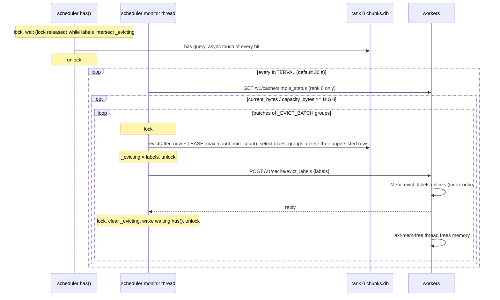

# DDR Pool Eviction Design

## Purpose

The DDR pool is a soft-capacity cache: each rank's `Mem` keeps compressed KV groups in host memory and only warns when it grows past `IAXL_DDR_POOL_SIZE_GB`. Per-rank LRU eviction cannot be used, because every rank would pick a different set of victims while the scheduler's `has()` keeps reporting the groups as present. This design makes the rank 0 SQLite database the single LRU index and the scheduler the single decision maker: the scheduler picks the labels, every worker drops exactly those labels, and only `has()` calls that touch in-flight labels ever wait.

## Challenges

There is one core challenge: **the scheduler and the ranks are separate processes. How do we synchronize eviction so data stays consistent and complete without blocking inference?** Everything below is a facet of that.

### Setting

- The scheduler lives in the EngineCore process as a has-only `KVStoreLocal`: it opens the rank 0 database, has no `Mem`, and does not know the pool usage.
- Each rank's worker is its own process (with TP=1 it shares the scheduler's process but runs on different threads), with its own `Mem`, LRU and database.
- Only two channels cross processes; there is no shared memory and no distributed lock:
  - the rank 0 SQLite database, written by both the scheduler and worker 0;
  - REST from the controller to the workers.
- `put`/`get` execute asynchronously on worker C++ threads. The scheduler cannot see their progress and cannot stop already queued tasks.

### Guarantees

- **Consistency**: every group the rank 0 database reports exists on every rank, in `Mem` or on disk.
- **Completeness**: on each rank, all layers of a group are present; never half a group.

Breaking either one makes `unzip_from_mem` miss at load time and the process aborts.

- **Performance**: on fast GPUs under high concurrency, eviction must not stall scheduling or forward passes.
  - Worker `put`/`get` are never paused.
  - `has()` waits at most for one short SQLite transaction; only a `has()` that queries labels currently being evicted waits for the workers to finish unlinking them.
  - Bulk `free()` holds no lock and runs on a worker background thread.

### Where the risks come from

- **A group being loaded gets evicted.** At least one scheduling step separates a `has()` hit from the `get()`. `Mem`'s LRU is refreshed only on `put`/`get`, so during that window these groups may still be the oldest.
- **Ranks evict different sets.** Each rank's LRU is independent and compression/decompression finish in different orders.
- **Re-save after truncation interleaves with eviction.** `has()` truncates at the first miss; hits after that point are reported as misses and the connector re-saves those already stored groups layer by layer ([kvshrink_connector.py](../../kvshrink/kvshrink_connector.py#L362-L392)). Those puts queue on C++ threads where no lock can hold them back. If a rank evicts the group mid re-save, the first layers are gone and the last layers are written again: half a group, while `put_finish` makes the database report it as present.
- **Queued background puts write to labels being evicted.** Puts land asynchronously; pausing puts at the worker's API layer would not stop tasks already in the queue.

### Approach

- **A single decision maker.** The rank 0 database is the LRU index. Only the scheduler selects labels; workers unlink exactly those labels and make no decision of their own, so all ranks evict the same set by construction.
- **A single synchronization point: the lock around `has()` in the scheduler process, plus an "evicting" set.**
  - Every `get`/`put` is driven by a `has()` result.
  - Under the lock only two things happen: select the labels and update the rank 0 database; record that batch in the `_evicting` set.
  - After unlocking, broadcast to all ranks and wait for them to unlink; then clear the set and wake waiters. Neither the broadcast nor the wait holds the lock.
  - A `has()` whose labels intersect the set waits until eviction finishes; a disjoint `has()` waits for one SQLite transaction only. Scheduling is never stalled by an eviction as a whole.
  - For the selected labels the effect equals "the whole eviction ran under the lock": by the time `has()` sees them, every rank has already dropped them. Persisted rows survive eviction in the database, so a `has()` hitting them must wait as well, otherwise `get()` could race a late unlink.
- **touch + lease covers the asynchronous window.** The scheduler cannot see the gap between `has()` returning and the `get`/`put` landing. `has()` touches every hit under the lock; eviction only selects rows with `last_access < now − LEASE` (default 300 s). A group reported by `has()` is not evicted by any rank within the lease, with one deliberate exception: when the lease-expired groups alone cannot bring usage down to `FORCE_WATERMARK`, the oldest leased groups are evicted as well (see *Lease vs. a pool that fills faster than leases expire* below).

### Why puts never need to be paused

**Re-save after truncation never leaves half a group:**

- `get_num_new_matched_tokens` passes **all** block hashes to `has()`. `has()` first touches every hit under the lock and truncates last; truncation only affects the return value, not the touch.
- So every group about to be re-saved already has `last_access = now`; no rank evicts it within the lease, and `put_finish` writes `now` again when the re-save completes.
- The re-saved data is identical to the old group (same hash), so overwriting layer by layer keeps the group complete throughout.
- The only precondition: the re-save lands within LEASE of the `has()` (known limitation 1).

**Queued background puts never write to labels being evicted.** The connector only saves blocks it queried through `has()`; at `has()` time each block is in one of three states:

- **Hit** (including hits past the truncation point that get re-saved): touched, protected by the lease.
- **Miss, and the row never existed**: the row can only come from a later `put_finish` with timestamp `now`, also protected by the lease.
- **Miss because the row was just deleted by eviction**: the label is in the evicting set, so `has()` waits until every rank has unlinked it. When `has()` returns, no rank holds the group and the put creates a brand new one.

A put to a selected label can therefore only happen after all ranks have unlinked it. No `truncate=False`, no worker-side filtering, no put pause; the connector is unchanged.

### Practical details

- **The database cannot tell which groups are in DDR.** `persisted` only says whether the disk copy exists; evicted persisted rows stay the oldest forever and would be selected again and again. Since LRU always cuts the oldest slice off the timeline, the scheduler keeps a cut `evicted_until`: rows with `last_access > evicted_until` are the DDR-resident groups. Rows sharing one timestamp are selected together or kept together, so `submit`/`touch` stamp the rows of one batch 1 µs apart: a `put_finish` or `has()` covering a whole request would otherwise form one tie and a cut inside it would sweep the entire batch.
- **The scheduler does not know the usage.** It reads rank 0's `GET /v1/cache/simple_status` through the controller, reusing `Mem`'s existing counters.
- **There was no automatic eviction.** A scheduler background thread polls rank 0 every `_MONITOR_INTERVAL_S` (10 s) to log the pool status, and every `IAXL_DDR_POOL_EVICT_INTERVAL_S` (default 30 s) checks the usage. At `usage ≥ HIGH` one pass frees the byte deficit in groups of average size: `max_count = ceil((current − LOW × capacity) / (current / group_count))` lease-expired groups to land near LOW, and `min_count = ceil((current − FORCE × capacity) / (current / group_count))` groups that are evicted even if their lease has not run out. `Mem` only warns when over budget, so `current` may exceed `capacity`; the byte form handles that directly.
- **Lease vs. a pool that fills faster than leases expire.** Hot workloads can leave fewer lease-expired groups than needed. `Record.evict(after, before, max_count, min_count)` takes up to `max_count` rows older than `before`; if that yields fewer than `min_count`, it moves the cut to the `min_count`-th oldest row regardless of `before`. **Warning:** evicting inside the lease reopens the asynchronous window for those (oldest) groups: a `get`/`put` that `has()` already promised may find them gone on some rank. FORCE is therefore a last resort for hot load, not the normal target: keep it well above LOW, and `envs.py` rejects values below 0.5.
- **Batching.** A multi-TB pool holds millions of groups, so one pass is split into `_EVICT_BATCH` (16384) groups per `evict_labels` request: each request stays small, and a `has()` on the selected labels waits for one batch, not the whole pass. `_evicted_until` advances per batch.
- **Lock hold time.** One SQLite transaction under the lock. Broadcast and unlinking run outside it; `Mem::evict_labels` only removes groups from its index and defers `free()` to a single dedicated queue thread (`iaxl-mem-free`), so overlapping batches never spawn extra threads. Only `has()` calls that query the evicted labels wait, estimated at tens of milliseconds.
- **Groups being decompressed.** Selected groups are past their lease (or, under FORCE, the oldest leased ones), and a `has()` hitting them during eviction is blocked, so normally no `get` is in flight for them. As a safety net the free thread calls `wait_deletion_guard()` before releasing a batch: a `get` that took its pointers before the unlink holds the guard until its decompression is done, and one that starts after the unlink cannot find the group. `evict_labels` itself does not wait, so the HTTP handler never blocks on loads of other groups; the unzip queue is single-threaded, so the counter drops to zero between loads and the free thread always makes progress.
- **Two writers on the rank 0 database.** The scheduler (`touch`/`evict`) and worker 0 (`put_finish`, `mark_persisted`). Both `touch` and `evict` use `BEGIN IMMEDIATE` to avoid `SQLITE_BUSY_SNAPSHOT`.
- **Comparable timestamps.** `now_seconds()` moved from `steady_clock` to `system_clock`, the same clock as Python's `time.time()`, valid across restarts.
- **TP=1 shares the process.** All new bindings release the GIL; the broadcast holds no Python lock and a waiting `has()` releases the condition lock, so there is no cycle.
- **Fail by aborting.** Every failure raises explicitly: a worker unlink error or timeout, a failed usage read, a SQLite error. The monitor thread turns any exception into `os.abort()` instead of skipping silently. At that point ranks may already diverge and `has()` may be stuck on `_evicting`; continuing would only defer the problem to load time.

**Summary:** no cross-process put pause and no distributed lock. One short in-process lock, one "evicting" set, one synchronous broadcast and a lease guarantee consistency and completeness, and only `has()` calls that actually involve the evicted labels block.

## Design

In one sentence: **the rank 0 database is the LRU index and the scheduler is the only decision maker.** `has()` queries and refreshes the rank 0 database under the lock. The scheduler's monitor thread selects labels under the lock, updates the database, marks them as "evicting", then unlocks; outside the lock it has every worker unlink those groups from `Mem` and clears the set when done. A `has()` that queries those labels waits for the eviction to finish; every other `has()` is unaffected. Memory is actually freed on a worker background thread.

### Configuration

| Variable | Default | Meaning |
|----------|---------|---------|
| `IAXL_DDR_POOL_TOTAL_SIZE_GB` | 80% of host RAM | DDR pool budget across all ranks, in whole GB. `setvars.sh` lowers it so that no rank exceeds 80% of one NUMA node (`host RAM / node count`), i.e. `min(0.8 × RAM, NUM_WORKERS × 0.8 × RAM / nodes)` |
| `IAXL_DDR_POOL_SIZE_GB` | `TOTAL / NUM_WORKERS` | Per-rank pool capacity; `capacity_bytes` in the formulas below. Without `setvars.sh` the Python fallback is 1/10 of available RAM |
| `IAXL_DDR_POOL_EVICT_HIGH_WATERMARK` | 0.90 | Eviction starts when `current_bytes / capacity_bytes` reaches this ratio |
| `IAXL_DDR_POOL_EVICT_LOW_WATERMARK` | 0.5 | Target usage after one eviction pass, evicting lease-expired groups only |
| `IAXL_DDR_POOL_EVICT_FORCE_WATERMARK` | 0.8 | Usage one pass must reach even if it has to evict groups still within their lease; `0.5 <= FORCE`, `LOW <= FORCE <= HIGH`. Keep well above LOW: it bypasses the lease guarantee |
| `IAXL_DDR_POOL_EVICT_LEASE_S` | 300 | Groups hit by `has()` within this many seconds are not evicted unless needed to reach FORCE; must exceed `has()` → last load/save of a request |
| `IAXL_DDR_POOL_EVICT_INTERVAL_S` | 30 | How often the scheduler checks the pool usage |

Defaults are those set by `setvars.sh`; the sizing helpers live in `tools/auto_config.sh` (`ddr_pool_total_size_gb`). `capacity_bytes == 0` means an unlimited pool and disables the check. The five `EVICT_*` variables take effect on the node that runs the scheduler (the daemon node under remote pool), like `IAXL_DDR_POOL_SIZE_GB`.

### Deployment forms

- **DP**: each DP group's scheduler uses only its own tp0 database and controller port, with one monitor thread each.
- **Remote pool**: the daemon's scheduler is the same has-only `KVStoreLocal`; client `has()` calls reach it over RPC. It is created on the first client registration, before any put, so the initial cut holds. `remote_pool/` is unchanged.
- **Multi-process TP**: the scheduler runs in the EngineCore process, workers in their own processes, connected over localhost HTTP.

### Operations

- To keep the whole current cache, pause eviction first, persist, then resume:
  `POST /v1/cache/evict {"enable": false}` → `POST /v1/cache/persist` → `POST /v1/cache/evict {"enable": true}`. Without `enable` the request only reports the current state.
- Old `chunks.db` files lack the `last_access` column and fail at startup; delete `_data/kvcache/{compressed,raw}/*/chunks.db*` before upgrading.
